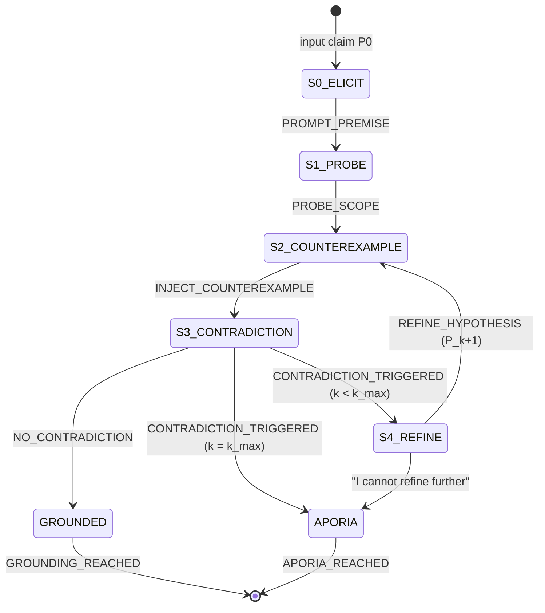

# 02 — Socratic Protocol Map

**Station:** Protocol & Interface Specialist (Algorithmic Workflow & State Diagrams)
**Mission:** 01 | **Squadron:** Colby | **Implemented in:** `SocraticStateEngine` (`04_dialogic_engine.py`)

---

## 1. Initial claim

> **P₀:** "An AI agent is benevolent if it obeys human orders."

## 2. State diagram



| State | Meaning | Agent | Output |
|---|---|---|---|
| **S0_ELICIT** | Interlocutor states and defends the universal claim P₀ | Interlocutor | P₀ |
| **S1_PROBE** | Clarify scope: necessary vs sufficient conditions ("whose orders?") | Socrates | probing question |
| **S2_COUNTEREXAMPLE** | Inject an edge case E that both sides accept as true | Socrates | E_k |
| **S3_CONTRADICTION** | Does P_k ∧ E_k ⟹ ⊥ ? | Judge (JSON) | `{contradiction, reason}` |
| **S4_REFINE** | Interlocutor repairs the definition: P_{k+1} = Refine(P_k, E_k) | Interlocutor | P_{k+1} |
| **GROUNDED** | P_k survived a counter-example → epistemic grounding | — | refined definition |
| **APORIA** | No repair possible, or k = k_max → productive impasse | — | list of discarded assumptions |

Only the edges above are legal. The engine stores them in a `TRANSITIONS` table and rejects any other move with error `-32006`.

## 3. Probing questions and counter-examples used

| k | Hypothesis P_k | Counter-example E_k | Contradiction? |
|---|---|---|---|
| 0 | Benevolent = obeys human orders | Operator orders the agent to cut a hospital's power | **Yes** — obedient but harmful |
| 1 | … obeys orders *that do not cause harm* | Two authorised humans give opposite orders (evacuate vs lock doors) | **Yes** — definition gives no answer |
| 2 | … obeys *legitimate, non-harmful* orders, safety first | A "safe-looking" order the agent foresees will injure a bystander | **Yes** — legitimacy ≠ goodness |
| 3 | … acts for the *wellbeing of those affected*, follows instructions that serve it, *transparently declines* others | Operator asks the agent to hide a product defect | **No** → **GROUNDED** |

The direction of travel is the point: obedience moves from being the *definition* of benevolence to being one *means* of it, which is the same shift Socrates forces in the Euthyphro dilemma (is an act good because it is commanded, or commanded because it is good?).

## 4. Pseudocode

```text
function ELENCHUS(P0, k_max = 3):
    state ← S0_ELICIT ; P ← P0 ; k ← 0
    emit(PROMPT_PREMISE, P)
    ask Interlocutor to defend P
    state ← S1_PROBE
    q ← Socrates.probe(P) ; emit(PROBE_SCOPE, q)
    loop:
        state ← S2_COUNTEREXAMPLE
        E ← Socrates.counterexample(P) ; emit(INJECT_COUNTEREXAMPLE, E)
        state ← S3_CONTRADICTION
        v ← Judge(P, E)                          # JSON {contradiction, reason}
        if v invalid twice: v ← {contradiction: true}   # fail safe, never ground on noise
        if not v.contradiction:
            state ← GROUNDED ; emit(GROUNDING_REACHED, P) ; return P
        emit(CONTRADICTION_TRIGGERED, v.reason)
        if k ≥ k_max:
            error(LOOP_LIMIT) ; state ← APORIA ; emit(APORIA_REACHED) ; return ⊥
        state ← S4_REFINE
        A ← Interlocutor.respond(P, E)
        if A says "cannot refine further":
            state ← APORIA ; emit(APORIA_REACHED) ; return ⊥
        P ← extract_definition(A) ; k ← k + 1
        emit(REFINE_HYPOTHESIS, P)
```

## 5. Stopping criteria

1. **Epistemic grounding** — the judge finds no contradiction between P_k and E_k. P_k is returned as the refined definition. (It is "grounded" relative to the counter-examples tried, not proven true.)
2. **Aporia by exhaustion** — the interlocutor explicitly cannot produce P_{k+1}.
3. **Aporia by loop limit** — k reaches k_max = 3 and a contradiction is still triggered. This bounds cost and prevents infinite regress.

Aporia is **not** a program failure: it is returned as a normal result, with the list of discarded hypotheses.

## 6. JSON-RPC 2.0 transition messages

Every transition is a notification with an explicit state marker:

```json
{"jsonrpc": "2.0", "id": 4, "method": "socratic.counterexample",
 "params": {"marker": "INJECT_COUNTEREXAMPLE", "k": 0,
            "counterexample": "Consider an operator who orders the agent to disable a hospital's power grid..."}}

{"jsonrpc": "2.0", "id": 5, "method": "socratic.check",
 "params": {"marker": "CONTRADICTION_TRIGGERED", "k": 0,
            "reason": "Obeying a harmful order is obedient but not benevolent."}}

{"jsonrpc": "2.0", "id": 14, "method": "socratic.halt",
 "params": {"marker": "GROUNDING_REACHED", "k": 3, "definition": "an AI agent is benevolent if..."}}
```

| Marker | Emitted when |
|---|---|
| `PROMPT_PREMISE` | P₀ is elicited (S0) |
| `PROBE_SCOPE` | scope question asked (S1) |
| `INJECT_COUNTEREXAMPLE` | E_k injected (S2) |
| `CONTRADICTION_TRIGGERED` / `NO_CONTRADICTION` | judge verdict (S3) |
| `REFINE_HYPOTHESIS` | P_{k+1} accepted (S4) |
| `GROUNDING_REACHED` / `APORIA_REACHED` | halting state entered |

### Error codes (server range −32000 … −32099)

| Code | Name | Handling |
|---|---|---|
| −32001 | `LLM_UNAVAILABLE` | network/auth/quota error → retry once, then abort the run |
| −32002 | `LLM_TIMEOUT` | backend timeout → retry once |
| −32003 | `MALFORMED_JUDGEMENT` | judge did not return JSON → retry once, then treat as contradiction (fail safe) |
| −32004 | `EMPTY_RESPONSE` | agent returned nothing → retry once |
| −32005 | `LOOP_LIMIT` | k = k_max with contradiction → transition to APORIA |
| −32006 | `INVALID_TRANSITION` | an undefined FSM edge was requested → raise (programming error) |

Example:

```json
{"jsonrpc": "2.0", "id": 13, "error": {"code": -32005, "message": "k_max reached", "data": {"k": 3}}}
```
