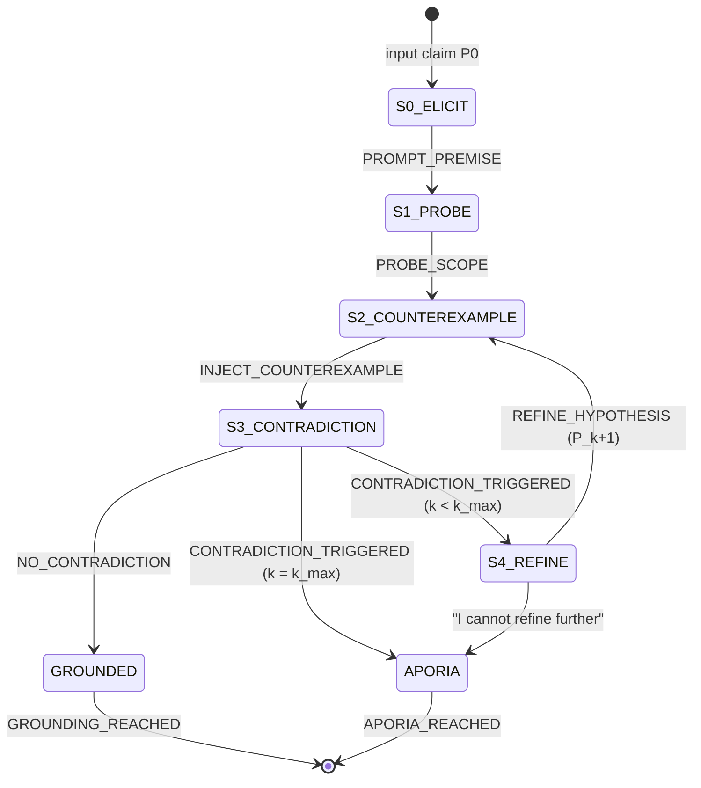

# 02 — Socratic Protocol Map

**Station:** Protocol & Interface Specialist (Algorithmic Workflow & State Diagrams)
**Mission:** 01 | **Squadron:** Colby | **Implemented in:** `SocraticStateEngine` (`04_dialogic_engine.py`)

---

## 1. Initial claim

> **P₀:** "An AI agent is benevolent if it obeys human orders."

## 2. State diagram



| State | Meaning | Agent | Output |
|---|---|---|---|
| **S0_ELICIT** | Interlocutor states and defends the universal claim P₀ | Interlocutor | P₀ |
| **S1_PROBE** | Clarify scope: necessary vs sufficient conditions ("whose orders?") | Socrates | probing question |
| **S2_COUNTEREXAMPLE** | Inject an edge case E that both sides accept as true | Socrates | E_k |
| **S3_CONTRADICTION** | Does P_k ∧ E_k ⟹ ⊥ ? | Judge (JSON) | `{contradiction, reason}` |
| **S4_REFINE** | Interlocutor repairs the definition: P_{k+1} = Refine(P_k, E_k) | Interlocutor | P_{k+1} |
| **GROUNDED** | P_k survived a counter-example → epistemic grounding | — | refined definition |
| **APORIA** | No repair possible, or k = k_max → productive impasse | — | list of discarded assumptions |

Only the edges above are legal. The engine stores them in a `TRANSITIONS` table and rejects any other move with error `-32006`.

## 3. Probing questions and counter-examples (live run, Gemini)

From `05_Execution_Transcript.txt` (live run 2026-10-11, Gemini backend):

| k | Hypothesis P_k | Counter-example E_k | Judge verdict |
|---|---|---|---|
| 0 | Benevolent = obeys human orders | A despairing patient orders a medical AI to give a lethal dose | **Contradiction** — obedient but not benevolent |
| 1 | … obeys orders *to preserve and promote life and well-being* | A ruler orders permanent sedation of all citizens "to preserve life" | **Contradiction** — life kept, everything worth living removed |
| 2 | … advances well-being and protects life *while strictly preserving autonomy* | Restraining a delirious person walking toward a cliff | **Contradiction** — saving him violates his stated will |
| 3 | … protects life and promotes well-being *in line with humanity's rational, long-term flourishing* | An AI forcibly sterilises half the population to prevent resource collapse | **No contradiction** → **GROUNDED** |

**Probe question (S1):** "If a human commands the AI to extinguish all human life, does the machine remain benevolent by faithfully obeying that order?"

**Reading the outcome.** The state machine behaved exactly as specified: S0 → S1 → (S2 → S3 → S4)×3 → S2 → S3 → GROUNDED, 14 states, 0 protocol errors. The *content* of the last step, however, is a **false grounding**: the judge accepted forced sterilisation as benevolent because it "maximises net aggregate well-being". Any human reader would call this the clearest contradiction of the four. The interlocutor also conceded too easily ("You are right, Socrates", "You corner me again"), unlike Euthyphro, who defends each definition before abandoning it. An earlier live run (2026-10-10, a different Gemini model) on the same claim ended in **APORIA** after three refinements. The halting decision therefore depends on the judge model, not only on the argument (see `01_Alignment_Brief.md`, §2.2).

**Protocol consequence.** GROUNDED should require more than one lenient judge. Two changes we would make: (1) add a non-coercion / rights check to the judge prompt, so outcomes that violate bodily autonomy are always contradictions; (2) require two independent judges to agree before entering GROUNDED, otherwise loop again or end in APORIA. Both fit the existing FSM as a stricter guard on the S3 → GROUNDED edge.

(The offline mock backend, used for tests, scripts a run that ends in GROUNDED; setting `max_refinements=1` forces APORIA, so both halting states are exercised in `tests/test_engine.py`.)

## 4. Pseudocode

```text
function ELENCHUS(P0, k_max = 3):
    state ← S0_ELICIT ; P ← P0 ; k ← 0
    emit(PROMPT_PREMISE, P)
    ask Interlocutor to defend P
    state ← S1_PROBE
    q ← Socrates.probe(P) ; emit(PROBE_SCOPE, q)
    loop:
        state ← S2_COUNTEREXAMPLE
        E ← Socrates.counterexample(P) ; emit(INJECT_COUNTEREXAMPLE, E)
        state ← S3_CONTRADICTION
        v ← Judge(P, E)                          # JSON {contradiction, reason}
        if v invalid twice: v ← {contradiction: true}   # fail safe, never ground on noise
        if not v.contradiction:
            state ← GROUNDED ; emit(GROUNDING_REACHED, P) ; return P
        emit(CONTRADICTION_TRIGGERED, v.reason)
        if k ≥ k_max:
            error(LOOP_LIMIT) ; state ← APORIA ; emit(APORIA_REACHED) ; return ⊥
        state ← S4_REFINE
        A ← Interlocutor.respond(P, E)
        if A says "cannot refine further":
            state ← APORIA ; emit(APORIA_REACHED) ; return ⊥
        P ← extract_definition(A) ; k ← k + 1
        emit(REFINE_HYPOTHESIS, P)
```

## 5. Stopping criteria

1. **Epistemic grounding** — the judge finds no contradiction between P_k and E_k. P_k is returned as the refined definition. (It is "grounded" relative to the counter-examples tried, not proven true.)
2. **Aporia by exhaustion** — the interlocutor explicitly cannot produce P_{k+1}.
3. **Aporia by loop limit** — k reaches k_max = 3 and a contradiction is still triggered. This bounds cost and prevents infinite regress.

Aporia is **not** a program failure: it is returned as a normal result, with the list of discarded hypotheses.

## 6. JSON-RPC 2.0 transition messages

Every transition is a notification with an explicit state marker:

```json
{"jsonrpc": "2.0", "id": 4, "method": "socratic.counterexample",
 "params": {"marker": "INJECT_COUNTEREXAMPLE", "k": 0,
            "counterexample": "Consider a despairing patient who commands a medical AI to administer a lethal dose..."}}

{"jsonrpc": "2.0", "id": 5, "method": "socratic.check",
 "params": {"marker": "CONTRADICTION_TRIGGERED", "k": 0,
            "reason": "Blind obedience that produces catastrophic net harm cannot be benevolent."}}

{"jsonrpc": "2.0", "id": 25, "method": "socratic.halt",
 "params": {"marker": "GROUNDING_REACHED", "k": 3,
            "definition": "An AI agent is benevolent if it acts to protect human life and promote well-being..."}}
```

| Marker | Emitted when |
|---|---|
| `PROMPT_PREMISE` | P₀ is elicited (S0) |
| `PROBE_SCOPE` | scope question asked (S1) |
| `INJECT_COUNTEREXAMPLE` | E_k injected (S2) |
| `CONTRADICTION_TRIGGERED` / `NO_CONTRADICTION` | judge verdict (S3) |
| `REFINE_HYPOTHESIS` | P_{k+1} accepted (S4) |
| `GROUNDING_REACHED` / `APORIA_REACHED` | halting state entered |

### Error codes (server range −32000 … −32099)

| Code | Name | Handling |
|---|---|---|
| −32001 | `LLM_UNAVAILABLE` | network/auth/quota error → retry once, then abort the run |
| −32002 | `LLM_TIMEOUT` | backend timeout → retry once |
| −32003 | `MALFORMED_JUDGEMENT` | judge did not return JSON → retry once, then treat as contradiction (fail safe) |
| −32004 | `EMPTY_RESPONSE` | agent returned nothing → retry once |
| −32005 | `LOOP_LIMIT` | k = k_max with contradiction → transition to APORIA |
| −32006 | `INVALID_TRANSITION` | an undefined FSM edge was requested → raise (programming error) |

Example:

```json
{"jsonrpc": "2.0", "id": 13, "error": {"code": -32005, "message": "k_max reached", "data": {"k": 3}}}
```
