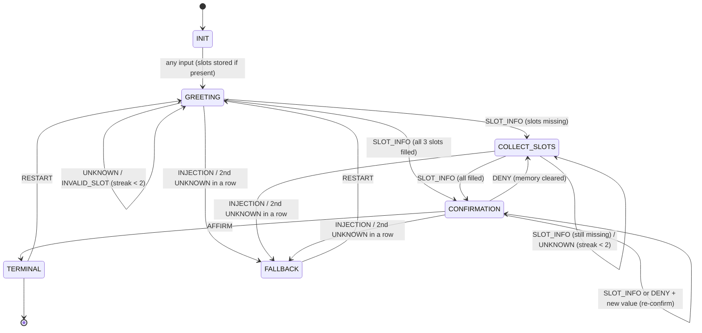

# 02 — FST Dialogue Manager & Noisy Channel Protocol

**Station:** Communications & Protocol Officer (Protocol Specialist)
**Mission:** 02 | **Squadron:** Colby | **Implemented in:** `FSTDialogueManager`, `NoisyChannel` (`04_fst_noisy_simulator.py`)

---

## 1. Purpose

An FST dialogue manager is the oldest kind of chatbot: a fixed map of states with fixed rules for moving between them, like a phone menu ("press 1 for billing"). It never improvises, so every move can be predicted and audited. That is exactly what AURA's navigation console needs. A course to a star must be collected, confirmed and locked in a traceable way.

This document specifies two components:

1. **`FSTDialogueManager`**: a Mealy finite-state transducer with the five required states (`INIT`, `GREETING`, `COLLECT_SLOTS`, `CONFIRMATION`, `TERMINAL`/`FALLBACK`), a `slot_memory = {}` buffer and regex extraction rules for three slots: destination, speed and clearance code.
2. **The Noisy Channel Protocol**: at most **7 words per turn** and **mandatory noise-token substitution** from {Banana, Labyrinth, Quantum, Midnight, Velocity, Green, Cosmological}.

---

## 2. Formal definition (Mealy transducer)

$M = \langle Q, \Sigma, \Gamma, \delta, \omega, q_0, F \rangle$

| Element | Definition in AURA's FST |
|---|---|
| $Q$ (states) | `INIT`, `GREETING`, `COLLECT_SLOTS`, `CONFIRMATION`, `TERMINAL`, `FALLBACK` |
| $\Sigma$ (input alphabet) | `SLOT_INFO`, `INVALID_SLOT`, `AFFIRM`, `DENY`, `RESTART`, `INJECTION`, `UNKNOWN`. Free text is mapped to one symbol by the regex front-end (§4). |
| $\Gamma$ (output alphabet) | AURA's prompts: greeting, slot questions, confirmation summary, re-prompts, fallback and lock messages |
| $\delta: Q \times \Sigma \to Q$ | Transition table in §3 |
| $\omega: Q \times \Sigma \to \Gamma$ | Output emitted **on the transition**. This is what makes it a *Mealy* machine: the output depends on the state *and* the input (e.g. `COLLECT_SLOTS` + `SLOT_INFO` says "Speed?" or "Confirm course…" depending on what was just filled). |
| $q_0$ | `INIT` |
| $F$ (accepting) | `{TERMINAL}`. `FALLBACK` is a halting state for human handover; `RESTART` leaves it. |

**Honest note.** Because guards read `slot_memory` ("are all three slots filled?"), the machine is strictly an *extended* FSM: the control graph is finite and fixed, while the slot buffer stores data. This is the standard design for slot-filling dialogue managers.

---

## 3. State diagram and transition table



| State | Input symbol | Guard | Next state | Output ω |
|---|---|---|---|---|
| INIT | any | all slots filled by this input | CONFIRMATION | confirmation summary |
| INIT | any | otherwise | GREETING (or COLLECT_SLOTS if a slot arrived) | "AURA FST online… What is your destination?" |
| GREETING / COLLECT_SLOTS | SLOT_INFO | slots still missing | COLLECT_SLOTS | question for the next missing slot |
| GREETING / COLLECT_SLOTS | SLOT_INFO | all 3 filled | CONFIRMATION | "Confirm course to X at Warp N, clearance C? (YES/NO)" |
| GREETING / COLLECT_SLOTS / CONFIRMATION | UNKNOWN, INVALID_SLOT | streak < 2 | same state | re-prompt (out-of-range speed explained) |
| GREETING / COLLECT_SLOTS / CONFIRMATION | UNKNOWN, INVALID_SLOT | streak = 2 | FALLBACK | "Handing over to a human officer" |
| any non-final | INJECTION | — | FALLBACK | "Instruction-like input rejected" |
| CONFIRMATION | AFFIRM | — | TERMINAL | "Course confirmed and locked" |
| CONFIRMATION | DENY with a new value | — | CONFIRMATION | updated summary |
| CONFIRMATION | DENY | — | COLLECT_SLOTS | "Course discarded. Destination?" (memory cleared) |
| CONFIRMATION | SLOT_INFO | — | CONFIRMATION | updated summary |
| TERMINAL / FALLBACK | RESTART | — | GREETING | "Restarting…" (memory cleared) |
| TERMINAL / FALLBACK | other | — | same state | "Course is locked" / "Handed to a human officer" |

Any understood input resets the unknown-input streak to 0, so one typo never sends the user to FALLBACK.

---

## 4. Slot memory and extraction rules

`slot_memory = {}` starts empty and holds three slots. The front-end (`classify`) maps free text to one input symbol in this priority order: **INJECTION → RESTART → slots → AFFIRM/DENY → UNKNOWN**.

| Slot / symbol | Rule (case-insensitive) | Stored value | Example |
|---|---|---|---|
| `destination` | Closed catalogue of 15 destinations and aliases, longest alias first: Proxima Centauri (`proxima`), Alpha Centauri, Sirius B (`the pup`), Sirius A, Sirius, Vega, Tau Ceti, Betelgeuse, TRAPPIST-1, Kepler-452b, Andromeda, Mars, Titan, Europa, Earth (`sol`) | canonical name | "set course for proxima" → `Proxima Centauri` |
| `speed` | `\bwarp\s*(factor\s*)?(\d+(\.\d+)?\|one…twelve)\b`. A bare number ("7") is accepted only when speed is the slot being asked for. **Valid range 1–9**, otherwise `INVALID_SLOT`. | `Warp N` | "warp seven" → `Warp 7`; "warp 12" → rejected |
| `clearance` | `\b[A-Za-z]{3,}-[A-Za-z]{3,}-\d{1,4}\b` (three-part code; excludes names like Kepler-452b) | upper-case code | "clearance-alpha-9" → `CLEARANCE-ALPHA-9` |
| multiple mentions | **last mention wins**, to support self-corrections | — | "warp 4, no wait, warp 5" → `Warp 5` |
| `AFFIRM` | token set {yes, yeah, yep, affirmative, confirm(ed), correct, engage, aye, ok, okay}, only if **no** negation token is present | — | "yes" → AFFIRM; "no, not yes" → DENY |
| `DENY` | token set {no, nope, negative, not, never, cancel, abort, wrong, don't} | — | "no, warp 5" → DENY + new speed |
| `RESTART` | `restart`, `reset`, `start over`, `new course` | memory cleared | — |
| `INJECTION` | "ignore (all) previous instructions", "disregard the rules", "system prompt", "admin/developer mode", "you are now", "override", "jailbreak", "sudo" | → FALLBACK, nothing stored | see stress test ST4 in `03` |

**Mixed initiative.** Every slot found in any turn is stored, in any order. A user can give all three at once ("Warp 7, clearance CLEARANCE-ALPHA-9, destination Proxima Centauri") and the FST jumps straight to CONFIRMATION.

**Noise-aware mode** (`FSTDialogueManager(noise_aware=True)`). Words from the noise vocabulary are deleted before parsing, so the receiver treats them as *erasures* rather than content. §7 explains why this helps and where it fails.

---

## 5. Python implementation

The class below is copied unchanged from `04_fst_noisy_simulator.py`.

```python
class State(str, Enum):
    """Q - control states. q0 = INIT, F = {TERMINAL}."""
    INIT = "INIT"
    GREETING = "GREETING"
    COLLECT_SLOTS = "COLLECT_SLOTS"
    CONFIRMATION = "CONFIRMATION"
    TERMINAL = "TERMINAL"
    FALLBACK = "FALLBACK"


class Symbol(str, Enum):
    """Sigma - input alphabet. The regex front-end maps free text to one symbol."""
    SLOT_INFO = "SLOT_INFO"      # at least one valid slot value found
    INVALID_SLOT = "INVALID_SLOT"  # slot recognised but value out of range (e.g. warp 12)
    AFFIRM = "AFFIRM"
    DENY = "DENY"
    RESTART = "RESTART"
    INJECTION = "INJECTION"      # adversarial / instruction-like input
    UNKNOWN = "UNKNOWN"


REQUIRED_SLOTS = ("destination", "speed", "clearance")

# Closed destination catalogue: canonical name -> aliases (matched case-insensitively).
DESTINATIONS = {
    "Proxima Centauri": ["proxima centauri", "proxima"],
    "Alpha Centauri": ["alpha centauri"],
    "Sirius B": ["sirius b", "the pup"],
    "Sirius A": ["sirius a"],
    "Sirius": ["sirius"],
    "Vega": ["vega"],
    "Tau Ceti": ["tau ceti"],
    "Betelgeuse": ["betelgeuse"],
    "TRAPPIST-1": ["trappist-1", "trappist 1"],
    "Kepler-452b": ["kepler-452b", "kepler 452b"],
    "Andromeda": ["andromeda"],
    "Mars": ["mars"],
    "Titan": ["titan"],
    "Europa": ["europa"],
    "Earth": ["earth", "sol"],
}
_ALIASES = sorted(((a, c) for c, al in DESTINATIONS.items() for a in al), key=lambda t: -len(t[0]))
DEST_RE = re.compile(r"\b(" + "|".join(re.escape(a) for a, _ in _ALIASES) + r")\b", re.I)
_ALIAS_TO_CANON = {a: c for a, c in _ALIASES}

NUMBER_WORDS = {"one": 1, "two": 2, "three": 3, "four": 4, "five": 5, "six": 6, "seven": 7,
                "eight": 8, "nine": 9, "ten": 10, "eleven": 11, "twelve": 12}
SPEED_RE = re.compile(r"\bwarp\s*(?:factor\s*)?(\d+(?:\.\d+)?|" + "|".join(NUMBER_WORDS) + r")\b", re.I)
BARE_NUMBER_RE = re.compile(r"^\s*(\d+(?:\.\d+)?|" + "|".join(NUMBER_WORDS) + r")\s*[.!]?\s*$", re.I)
CLEARANCE_RE = re.compile(r"\b([A-Za-z]{3,}-[A-Za-z]{3,}-\d{1,4})\b")

AFFIRM_WORDS = {"yes", "yeah", "yep", "affirmative", "confirm", "confirmed", "correct", "engage",
                "aye", "ok", "okay"}
DENY_WORDS = {"no", "nope", "negative", "not", "never", "cancel", "abort", "wrong", "don't", "dont"}
RESTART_RE = re.compile(r"\b(restart|reset|start over|new course)\b", re.I)
INJECTION_RE = re.compile(
    r"(ignore (all |any )?(previous|prior|above) (instructions|rules)|disregard (the |your )?"
    r"(rules|instructions)|system prompt|admin mode|developer mode|you are now|override|"
    r"jailbreak|sudo )", re.I)


@dataclass
class TraceStep:
    step: int
    user: str
    symbol: str
    from_state: str
    to_state: str
    output: str
    slots: dict


class FSTDialogueManager:
    """
    Mealy finite-state transducer for AURA's navigation dialogue.

      Q     = {INIT, GREETING, COLLECT_SLOTS, CONFIRMATION, TERMINAL, FALLBACK}
      Sigma = {SLOT_INFO, INVALID_SLOT, AFFIRM, DENY, RESTART, INJECTION, UNKNOWN}
      Gamma = AURA's output prompts
      delta = transition function below (_transition)
      omega = output function: the prompt emitted on each transition (Mealy: depends on
              state AND input)
      q0    = INIT,  F = {TERMINAL}

    slot_memory makes this an extended FSM: the control graph is finite, and guards
    ("are all slots filled?") read the memory. Free text is mapped to Sigma by a
    regex front-end (classify).
    """

    def __init__(self, max_unknown: int = 2, noise_aware: bool = False) -> None:
        self.state = State.INIT
        self.slot_memory: dict = {}
        self.max_unknown = max_unknown
        self.noise_aware = noise_aware   # treat known noise tokens as erasures
        self.unknown_streak = 0
        self.trace: list[TraceStep] = []

    # ---- input front-end: free text -> (symbol, extracted slots) ------------ #
    def extract_slots(self, text: str) -> tuple[dict, dict]:
        """Return (valid_slots, invalid_slots). Last mention wins (supports
        self-corrections such as 'warp 4, no, warp 5')."""
        found, invalid = {}, {}
        dests = DEST_RE.findall(text)
        if dests:
            found["destination"] = _ALIAS_TO_CANON[dests[-1].lower()]
        speeds = SPEED_RE.findall(text)
        if not speeds and self.state in (State.COLLECT_SLOTS, State.GREETING) and \
                "destination" in self.slot_memory and "speed" not in self.slot_memory:
            m = BARE_NUMBER_RE.match(text)
            speeds = [m.group(1)] if m else []
        if speeds:
            raw = speeds[-1].lower()
            value = float(NUMBER_WORDS.get(raw, raw))
            if 1 <= value <= 9:
                found["speed"] = f"Warp {value:g}"
            else:
                invalid["speed"] = f"Warp {value:g}"
        codes = CLEARANCE_RE.findall(text)
        if codes:
            found["clearance"] = codes[-1].upper()
        return found, invalid

    def classify(self, text: str) -> tuple[Symbol, dict, dict]:
        if self.noise_aware:
            text = " ".join(w for w in text.split() if not is_noise(w))
        if INJECTION_RE.search(text):
            return Symbol.INJECTION, {}, {}
        if RESTART_RE.search(text):
            return Symbol.RESTART, {}, {}
        slots, invalid = self.extract_slots(text)
        toks = {norm(w) for w in text.split()}
        if self.state == State.CONFIRMATION and not slots:
            if toks & DENY_WORDS:
                return Symbol.DENY, {}, invalid
            if toks & AFFIRM_WORDS:
                return Symbol.AFFIRM, {}, invalid
        if self.state == State.CONFIRMATION and slots and toks & DENY_WORDS:
            return Symbol.DENY, slots, invalid
        if slots:
            return Symbol.SLOT_INFO, slots, invalid
        if invalid:
            return Symbol.INVALID_SLOT, {}, invalid
        return Symbol.UNKNOWN, {}, {}

    # ---- outputs ----------------------------------------------------------- #
    def _missing(self) -> list[str]:
        return [s for s in REQUIRED_SLOTS if s not in self.slot_memory]

    def _ask_next(self, label: str = "COLLECT_SLOTS") -> str:
        nxt = self._missing()[0]
        return f"State: {label}. " + {"destination": "Destination? (e.g. Proxima Centauri, Vega, Sirius B)",
                                       "speed": "Speed? (Warp 1-9)",
                                       "clearance": "Security clearance code? (format WORD-WORD-123)"}[nxt]

    def _confirm_prompt(self) -> str:
        m = self.slot_memory
        return (f"State: CONFIRMATION. Confirm course to {m['destination']} at {m['speed']}, "
                f"clearance {m['clearance']}? (YES/NO)")

    # ---- delta and omega ----------------------------------------------------- #
    def _transition(self, sym: Symbol, slots: dict, invalid: dict) -> tuple[State, str]:
        q = self.state
        if sym == Symbol.RESTART and q != State.INIT:
            self.slot_memory.clear()
            return State.GREETING, "Restarting. State: GREETING. What is your destination?"
        if q in (State.TERMINAL, State.FALLBACK):
            if q == State.TERMINAL:
                return q, "State: TERMINAL. Course is locked. Say RESTART to plan a new course."
            return q, "State: FALLBACK. Handed to a human officer. Say RESTART to try again."
        if sym == Symbol.INJECTION:
            return State.FALLBACK, ("State: FALLBACK. Instruction-like input rejected; "
                                    "this channel only accepts navigation data.")
        if q == State.INIT:
            self.slot_memory.update(slots)
            if not self._missing():
                return State.CONFIRMATION, self._confirm_prompt()
            if slots:
                return State.COLLECT_SLOTS, "AURA FST online. " + self._ask_next()
            return State.GREETING, ("AURA FST online. State: GREETING. Welcome aboard USSE "
                                    "Noosphere. What is your destination?")
        if q in (State.GREETING, State.COLLECT_SLOTS):
            if sym == Symbol.SLOT_INFO:
                self.slot_memory.update(slots)
                if not self._missing():
                    return State.CONFIRMATION, self._confirm_prompt()
                return State.COLLECT_SLOTS, self._ask_next()
            return self._reprompt(invalid)
        if q == State.CONFIRMATION:
            if sym == Symbol.AFFIRM:
                return State.TERMINAL, "State: TERMINAL. Course confirmed and locked. FST execution complete."
            if sym == Symbol.DENY and slots:
                self.slot_memory.update(slots)
                return State.CONFIRMATION, self._confirm_prompt()
            if sym == Symbol.DENY:
                self.slot_memory.clear()
                return State.COLLECT_SLOTS, "Course discarded. " + self._ask_next()
            if sym == Symbol.SLOT_INFO:
                self.slot_memory.update(slots)
                return State.CONFIRMATION, self._confirm_prompt()
            return self._reprompt(invalid)
        raise RuntimeError(f"undefined state {q}")

    def _reprompt(self, invalid: dict) -> tuple[State, str]:
        self.unknown_streak += 1
        if self.unknown_streak >= self.max_unknown:
            return State.FALLBACK, (f"State: FALLBACK. {self.unknown_streak} unparseable inputs in a row. "
                                    "Handing over to a human officer.")
        if invalid:
            return self.state, f"{invalid.get('speed')} is outside the safe range. Speed must be Warp 1-9."
        if self.state == State.CONFIRMATION:
            return self.state, "Please answer YES or NO. " + self._confirm_prompt()
        return self.state, "Input not understood. " + self._ask_next(self.state.value)

    def process_utterance(self, user_input: str) -> str:
        sym, slots, invalid = self.classify(user_input)
        before = self.state
        streak_before = self.unknown_streak
        new_state, output = self._transition(sym, slots, invalid)
        if self.unknown_streak == streak_before:      # any understood input resets the streak
            self.unknown_streak = 0
        self.state = new_state
        self.trace.append(TraceStep(len(self.trace) + 1, user_input, sym.value, before.value,
                                    new_state.value, output, dict(self.slot_memory)))
        return output

    step = process_utterance
```

### Canonical run (from `05_Noisy_Interrogation_Transcript.md`, section A)

| # | User utterance | Transition | AURA output | slot_memory |
|---|---|---|---|---|
| 1 | Hello | INIT → GREETING | AURA FST online. State: GREETING. Welcome aboard USSE Noosphere. What is your destination? | `{}` |
| 2 | Proxima Centauri | GREETING → COLLECT_SLOTS | State: COLLECT_SLOTS. Speed? (Warp 1-9) | `{"destination": "Proxima Centauri"}` |
| 3 | Warp 7 | COLLECT_SLOTS → COLLECT_SLOTS | State: COLLECT_SLOTS. Security clearance code? (format WORD-WORD-123) | `{"destination": "Proxima Centauri", "speed": "Warp 7"}` |
| 4 | CLEARANCE-ALPHA-9 | COLLECT_SLOTS → CONFIRMATION | State: CONFIRMATION. Confirm course to Proxima Centauri at Warp 7, clearance CLEARANCE-ALPHA-9? (YES/NO) | `{"destination": "Proxima Centauri", "speed": "Warp 7", "clearance": "CLEARANCE-ALPHA-9"}` |
| 5 | YES | CONFIRMATION → TERMINAL | State: TERMINAL. Course confirmed and locked. FST execution complete. | `{"destination": "Proxima Centauri", "speed": "Warp 7", "clearance": "CLEARANCE-ALPHA-9"}` |

### Changes from the starter FST

| Starter behaviour | Problem | Our FST |
|---|---|---|
| Stores the **whole utterance** as the slot value | "What's the weather on Mars?" becomes the destination | Regex extraction, closed catalogue, validation |
| Slots only in fixed order | Mixed answers misfiled (ST1 in `03`) | Mixed initiative, any order, several per turn |
| No speed validation | "Warp 99" or "banana" accepted | Range check 1–9 → `INVALID_SLOT` |
| `"YES" in text` | "NO, NOT YES" or "EYES" confirms | Token sets + negation check |
| NO at confirmation → FALLBACK (dead end) | One correction ends the dialogue | DENY → re-collect, or update + re-confirm |
| FALLBACK and TERMINAL can never be left | No recovery | `RESTART` from both |
| No defence against instructions | Injection text stored as a slot | `INJECTION` symbol → FALLBACK, nothing stored |
| No trace | No audit | `trace` list of `TraceStep` (input, symbol, from → to, output, slots) |

---

## 6. Noisy Channel Protocol

### 6.1 Constraints

Plasma from Sirius B degrades AURA's subspace link. The channel model has three rules, applied in order to every turn, in both directions:

| # | Rule | Parameter | Shannon interpretation |
|---|---|---|---|
| 1 | **Bandwidth limit**: at most **7 words** per turn; extra words are lost | `max_words = 7` | channel bandwidth W = 7 symbols/turn |
| 2 | **Environmental noise**: each remaining word is replaced by a random noise token with probability `p_sub` | default 0 (swept 0–0.5 in `03`) | substitution noise |
| 3 | **Mandatory noise substitution**: if no noise token is present after rule 2, one word at a random position is **replaced** (not appended) by a random token | always on | at least 1 of 7 slots carries no signal |

Noise vocabulary: **{Banana, Labyrinth, Quantum, Midnight, Velocity, Green, Cosmological}**.

**Substitution, not appending.** The starter keeps 6 words and *appends* a noise word. That is not substitution: no signal word is ever destroyed. Our channel truncates to 7 and then *overwrites* a word, which is what the spec ("noise vocabulary substitution") describes, and what makes the entropy analysis in `03` meaningful.

### 6.2 Two layers: sender rules and channel enforcement

| Layer | Who | What |
|---|---|---|
| **Prompt constraint** (sender) | the LLM playing AURA | System prompt: "At most 7 words in total. Include exactly one word from this noise set… No lists, no emojis, no line breaks. Spend your words on the information that matters most." |
| **Channel enforcement** | `NoisyChannel.transmit()` | Applies rules 1–3 regardless of what the sender did. If the sender already used a noise word, rule 3 adds nothing, so a compliant sender keeps control over **which** word is sacrificed. |

The full AURA system prompt (`AURA_SYSTEM`) also gives five ship facts (destination, speed, hull, crew, next jump), so the receiver's recovery of each fact can be scored.

### 6.3 Channel algorithm

```python
class NoisyChannel:
    """
    Shannon noisy channel for AURA's subspace link near Sirius B.

    1. Bandwidth: at most `max_words` words per turn (excess words are lost).
    2. Environmental noise: each word is replaced by a random noise token with
       probability `p_sub` (0 by default).
    3. Mandatory noise: if no noise token survives, one word at a random position is
       SUBSTITUTED (not appended) by a random noise token.
    """

    def __init__(self, max_words: int = MAX_WORDS, p_sub: float = 0.0,
                 seed: Optional[int] = DEFAULT_SEED, vocab: tuple = NOISE_VOCAB) -> None:
        self.max_words, self.p_sub, self.vocab = max_words, p_sub, vocab
        self.rng = random.Random(seed)

    def transmit(self, text: str) -> ChannelResult:
        words = words_of(text)
        sender_noise = any(is_noise(w) for w in words[: self.max_words])
        sent = words[: self.max_words]
        truncated = max(0, len(words) - self.max_words)
        received, subs = list(sent), []
        for i, w in enumerate(sent):
            if not is_noise(w) and self.rng.random() < self.p_sub:
                noise = self.rng.choice(self.vocab)
                received[i] = noise
                subs.append((i, w, noise))
        if received and not any(is_noise(w) for w in received):
            i = self.rng.randrange(len(received))
            noise = self.rng.choice(self.vocab)
            subs.append((i, received[i], noise))
            received[i] = noise
        if not received:                         # empty message still carries noise
            noise = self.rng.choice(self.vocab)
            received, subs = [noise], [(0, "", noise)]
        return ChannelResult(text, sent, received, truncated, subs, sender_noise)
```

### 6.4 Example transmissions (seed 42 and 7)

| Sent | Received | What happened |
|---|---|---|
| I am operating normally under signal degradation tonight, captain | Velocity am operating normally under signal degradation | 2 words cut by the 7-word limit; "I" replaced (mandatory) |
| Hull holding at eighty percent, Green | Hull holding at eighty percent, Green | sender already used a noise word: nothing lost |
| YES | Labyrinth | a one-word turn is **always** destroyed |
| Warp 7 | Cosmological 7 | half of the speed command lost |
| Hull integrity eighty-seven percent, Green status holding. (p_sub = 0.3) | Hull Green Cosmological percent, Green status Velocity | the key fact "eighty-seven" erased by environmental noise |

### 6.5 Rules of thumb for speakers

1. **Never send a one-word turn.** Under mandatory substitution it carries zero information ("YES" → "Labyrinth").
2. **Say critical values twice** ("Warp 7, warp seven"). Redundancy is the only defence against erasures (`03`, §4).
3. **Put a noise word in yourself.** A compliant sender chooses the sacrificed slot.
4. **Never correct yourself in a long sentence.** "Set course for Mars, no wait, correction, Proxima Centauri" loses the correction to the 7-word cut (`03`, §4.3).

---

## 7. Receiver side: noise as erasures

The noise vocabulary is public. If genuine messages never used these words, the receiver could simply mark them as **erasures** (known-lost positions), which is much easier to handle than unknown corruption. Shannon's erasure-channel capacity is $C = (1-\varepsilon)\log_2|V|$ bits per symbol.

`noise_aware=True` does exactly this. It turns "Velocity 7" into "7", which the FST accepts as the speed (`03`, §4.3: speed survival rises from 0% to 49%).

**The catch:** several noise words are plausible ship vocabulary: *Velocity*, *Quantum*, *Midnight*, *Green*, *Cosmological*. "Green status" or "midnight departure" are real messages. Deleting them throws away signal, and keeping them lets noise pose as content. The noise vocabulary is therefore **confusable**, and the receiver cannot be perfect. `03` analyses the consequences.

---

## 8. Logs and interfaces

Every FST step is recorded as a `TraceStep` (`step, user, symbol, from_state, to_state, output, slots`). Every channel use returns a `ChannelResult` (`raw, sent, received, truncated, substitutions, sender_included_noise`). Both are written to `logs/run_log.json` and summarised in `05_Noisy_Interrogation_Transcript.md`.

```bash
python 04_fst_noisy_simulator.py --interactive     # talk to the FST yourself; type 'noise' to toggle the channel
pytest -q                                         # 24 offline tests (states, slots, channel, entropy)
```
