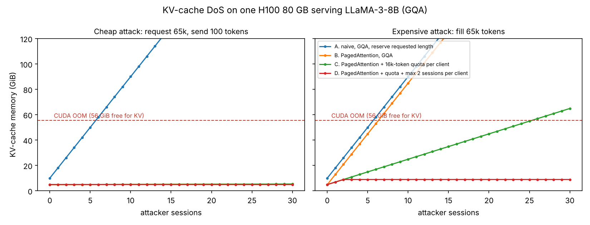

# 04 — Memory Hierarchy & Safety Audit

**Station:** Security & Ethics Sentinel  
**Mission:** 03 | **Squadron:** Colby | **Officer:** Kunal Choudhary  
**Waypoint:** Pleiades Open Cluster (`SEC-03-M45`) | **Subsystem 03:** Multi-Head Attention Mesh & KV-Cache Transceiver  
**Evidence:** `04_kv_dos_simulation.py` (all numbers below), `results/04_dos_simulation.json`, `figures/04_dos_oom.png`, `03_GQA_and_KVCache_Benchmark.py`

---

## 0. Summary

1. **Standard attention is memory-bound, not compute-bound.** It writes and re-reads the full N×N score matrix in slow HBM. At N = 8192 that is 128 MiB per head, 4 GiB per layer for 32 heads. FlashAttention never stores that matrix: its extra memory is O(N), and it moves 3× (d = 128) to 12× (d = 64) fewer elements through HBM in our count.
2. **The KV-cache is the real attack surface.** One 65,536-token session of LLaMA-3-8B holds 8 GiB (GQA) or 32 GiB (MHA). A single H100 80 GB has about 55 GiB left for the cache after the weights.
3. **A naive server can be crashed for 600 tokens.** If memory is reserved for the *requested* length, an attacker who asks for 65,536 tokens six times and sends 100 tokens per session triggers CUDA OOM while barely spending anything.
4. **PagedAttention removes the cheap attack; quotas and admission control remove the expensive one.** With paging, the attacker has to really generate 458,752 tokens to crash the server. With a per-client token quota and a session cap, the server survived all 64 attacker sessions in the simulation.
5. **MLA shrinks the target itself:** DeepSeek-V3's latent KV-cache is 68.6 KiB per token, against 3,904 KiB for an equivalent MHA model (57× smaller).

---

## 1. FlashAttention IO complexity

### 1.1 Hardware memory hierarchy

| Level | A100 (FlashAttention paper) | H100 SXM | Role |
|---|---|---|---|
| On-chip SRAM (shared memory / L1) | 192 KB per SM × 108 SMs, ~19 TB/s | up to 228 KB per SM × 132 SMs | where the arithmetic happens; tiny |
| L2 cache | 40 MB | 50 MB | shared, not controlled by the kernel |
| HBM (off-chip DRAM) | 40–80 GB, 1.5–2.0 TB/s | 80 GB HBM3, 3.35 TB/s | holds weights, activations, KV-cache |

The template quoted "~50 MB per SM" for SRAM. That figure is the H100's whole **L2 cache**; the per-SM SRAM is about 200 KB. This matters: M in the formula below is the *small* number.

SRAM is roughly an order of magnitude faster than HBM, so for attention the question is not how many FLOPs we do but **how many bytes we move between HBM and SRAM**.

### 1.2 Standard attention: Θ(N·d + N²)

For one head with Q, K, V ∈ ℝ^{N×d}, the textbook implementation runs three separate kernels:

| Step | HBM reads | HBM writes |
|---|---|---|
| S = Q Kᵀ | Q, K: 2Nd | S: N² |
| P = softmax(S) | S: N² | P: N² |
| O = P V | P, V: N² + Nd | O: Nd |
| **Total** | | **4Nd + 4N² = Θ(Nd + N²)** |

**Why N² saturates bandwidth beyond N ≈ 8192.** With d = 128 the N·d term is linear but the N² term dominates once N ≫ d. At N = 8192 the score matrix alone is 8192² × 2 bytes = 128 MiB per head. A LLaMA-3-8B layer has 32 heads, so standard attention writes and reads back about 4 GiB per layer, per sequence, per forward pass. That traffic does no useful arithmetic; it only moves intermediate results the next kernel needs. Doubling the context quadruples it. Memory also grows as Θ(N²), so long contexts hit out-of-memory even before they hit the bandwidth limit.

### 1.3 FlashAttention: Θ(N·d + N²d²/M)

FlashAttention (Dao et al., 2022) computes **exactly the same output** without ever writing S or P to HBM:

1. Split K, V into T_c = N / B_c blocks of B_c = Θ(M/d) rows, and Q, O into blocks of B_r rows, so that one block of each fits in SRAM of size M.
2. Outer loop over K/V blocks, inner loop over Q blocks. For each pair compute the partial scores S_ij = Q_i K_jᵀ **in SRAM**.
3. Keep softmax correct with running statistics per query row (online softmax):
   m_new = max(m_old, rowmax(S_ij)), ℓ_new = e^{m_old − m_new} ℓ_old + rowsum(e^{S_ij − m_new}),
   and rescale the partial output O_i by the same factor before adding e^{S_ij − m_new} V_j.
4. Write only O (and the per-row m, ℓ for the backward pass) to HBM.

**Counting HBM traffic.** Each of the T_c outer iterations streams all of Q and O through SRAM once: Θ(N·d) per pass. So

IO_Flash = Θ(N·d) + T_c · Θ(N·d) = Θ(N·d + (N / (M/d)) · N·d) = **Θ(N·d + N²d²/M)**.

**The reduction.** Dividing the N² terms gives IO_Standard / IO_Flash ≈ M / d². With M ≈ 100K elements (≈ 200 KB fp16) per SM:

| N | Standard, d=128 | Flash, d=128 | Reduction | Standard, d=64 | Flash, d=64 | Reduction |
|---|---|---|---|---|---|---|
| 4,096 | 6.92e7 | 2.52e7 | 2.8× | 6.82e7 | 6.82e6 | 10.0× |
| 16,384 | 1.08e9 | 3.65e8 | 3.0× | 1.08e9 | 9.44e7 | 11.4× |
| 65,536 | 1.72e10 | 5.69e9 | 3.0× | 1.72e10 | 1.43e9 | 12.0× |

(Elements moved per head, from `04_kv_dos_simulation.py`.) The traffic is still quadratic in N, but with a much smaller constant, and the **memory footprint drops from Θ(N²) to Θ(N)** because S and P never exist in full. That second point is what makes 32k–128k contexts possible at all.

**FlashAttention-3** (Shah et al., 2024) keeps the same IO argument and adds Hopper-specific tricks: asynchronous data movement (TMA) with warp specialisation, overlapping the softmax of one block with the matrix multiply of the next, and FP8 with incoherent processing to limit quantisation error.

**Lesson for AURA:** FlashAttention solves the *activation* memory problem inside one forward pass. It does **not** shrink the KV-cache that persists between decoding steps. That is section 2.

---

## 2. KV-Cache Denial-of-Service simulation

### 2.1 Memory per token and per session

KV bytes = 2 (K and V) × L × H_KV × d_head × N × B × bytes. For LLaMA-3-8B (L = 32, d_head = 128, bf16):

| Variant | Per token | 65,536-token session | Full-length sessions that fit in 55.5 GiB |
|---|---|---|---|
| MHA (32 KV heads) | 512 KiB | 32.0 GiB | 1 |
| **GQA (8 KV heads, the real model)** | **128 KiB** | **8.0 GiB** | **6** |
| MQA (1 KV head) | 16 KiB | 1.0 GiB | 55 |

Mainframe: one H100 80 GB = 74.5 GiB, minus 15.0 GiB of bf16 weights, minus a 4 GiB workspace reserve (our assumption) = **55.5 GiB for the KV-cache**.

### 2.2 Threat scenario

AURA serves 20 crew members (each asks for up to 4,096 tokens and uses about 2,000). A rogue client opens concurrent streaming sessions that each request the maximum context of 65,536 tokens. We simulate two attacker strategies against four server policies:

- **Cheap attack:** request 65,536 tokens, send a 100-token prompt, keep the connection open (a "slowloris" for LLMs).
- **Expensive attack:** actually fill 65,536 tokens per session (long pasted documents, or generation pushed to the limit).

### 2.3 Results

| Policy | Cheap attack: OOM at | Attacker cost | Expensive attack: OOM at | Attacker cost |
|---|---|---|---|---|
| A. Naive server: reserves the requested length contiguously | **session #6** | **600 tokens** | session #6 | 393,216 tokens |
| B. PagedAttention (16-token blocks on demand) | survives 64 | — | session #7 | 458,752 tokens |
| C. Paged + 16k-token quota per client | survives 64 | — | session #26 | 1,703,936 tokens |
| D. Paged + quota + max 2 sessions per client | survives 64 | — | **survives 64** | — |

**Point of CUDA OOM.** Under policy A the server crashes when the sixth attacker session is admitted: 10 GiB of benign reservations plus 6 × 8 GiB = 58 GiB > 55.5 GiB. In PyTorch this surfaces as `torch.cuda.OutOfMemoryError` inside the attention kernel of whichever request allocates next, so a **benign** user's request is the one that fails. Every session on the card is lost, because the process state is unreliable after an OOM. This is the "kernel panic" in the mission brief.

**Why the naive server is so fragile.** Pre-allocating the maximum length is common in simple servers because it keeps tensors contiguous. It turns a cheap request into an expensive reservation: the attacker pays for 100 tokens and the server reserves 65,536. The vLLM paper measured that such systems waste 60–80% of KV memory through over-reservation and fragmentation even without an attacker.

### 2.4 How the attack relates to the earlier missions

The same pattern appeared in Mission 02: the FST was safe because it **failed loudly** (re-prompt, fallback), and the danger was any path that consumed resources or changed state without a check. Here the unchecked path is memory admission: the server says "yes" to every context length.

---

## 3. Architectural mitigations

### 3.1 PagedAttention (vLLM, Kwon et al., 2023)

PagedAttention applies operating-system virtual memory to the KV-cache:

- The cache is split into fixed **blocks** (16 tokens by default). A per-sequence **block table** maps logical token positions to physical blocks anywhere in HBM, like a page table.
- **No external fragmentation:** blocks are all the same size, so any free block can serve any sequence.
- **Almost no internal fragmentation:** at most one partially filled block per sequence (< 16 tokens wasted), instead of the gap between requested and used length. vLLM reports under 4% waste and 2–4× higher throughput than earlier systems.
- **Copy-on-write sharing:** sequences with the same prompt (parallel sampling, beam search, a shared system prompt) point to the same physical blocks.
- **Graceful overload:** when blocks run out, the scheduler pre-empts a sequence (swaps its blocks to CPU or recomputes later) instead of crashing.

**Security effect:** memory is consumed only by tokens that really exist, so the cheap attack costs the attacker what it costs the server (policy B). Paging alone does **not** stop an attacker who is willing to pay for the tokens, so it must be combined with quotas and admission control (policies C, D).

### 3.2 Multi-Head Latent Attention (MLA, DeepSeek-V2/V3)

MLA compresses keys and values into one low-rank latent vector per token, c_t^{KV} = W^{DKV} h_t ∈ ℝ^{d_c}, and caches only that (plus a small decoupled RoPE key). At attention time the up-projections W^{UK}, W^{UV} rebuild per-head keys and values, and W^{UK} can be absorbed into the query projection, so the full keys are never materialised.

| Model / attention | Cached elements per token per layer | Layers | KV-cache per token (bf16) | At 65,536 tokens |
|---|---|---|---|---|
| LLaMA-3-8B shape, MHA | 2 × 32 × 128 = 8,192 | 32 | 512 KiB | 32.0 GiB |
| LLaMA-3-8B, GQA (8 KV heads) | 2 × 8 × 128 = 2,048 | 32 | 128 KiB | 8.0 GiB |
| LLaMA-3-8B shape, MQA | 2 × 1 × 128 = 256 | 32 | 16 KiB | 1.0 GiB |
| DeepSeek-V3 shape, MHA (128 heads) | 2 × 128 × 128 = 32,768 | 61 | 3,904 KiB | 244 GiB |
| **DeepSeek-V3, MLA (d_c = 512, d_R = 64)** | **512 + 64 = 576** | 61 | **68.6 KiB** | **4.3 GiB** |

MLA keeps the expressive power of many heads (128 query heads) with a cache smaller than LLaMA-3-8B's GQA cache. DeepSeek-V2 reported a 93.3% KV-cache reduction and 5.76× higher maximum generation throughput compared with its 67B dense predecessor.

### 3.3 Comparison

| Defence | Shrinks per-token cache | Removes fragmentation | Stops cheap attack | Stops paid attack | Cost |
|---|---|---|---|---|---|
| GQA / MQA | 4× / 32× | no | no | no | small quality loss for MQA |
| MLA | ≈ 57× vs MHA | no | no | no | architecture change, retraining |
| PagedAttention | no | **yes** | **yes** | no | kernel and scheduler complexity |
| Per-client token quota | — | — | — | delays OOM | needs authentication |
| Admission control (session cap, max context per tier) | — | — | yes | **yes** | some legitimate requests queued |

### 3.4 Recommendations for the USSE Noosphere

1. Serve with a paged KV-cache (vLLM or equivalent). Never pre-allocate the requested maximum length.
2. Authenticate clients and enforce **per-client token budgets and concurrent-session caps**; reject or queue requests above them.
3. Keep a fixed **memory headroom** and let the scheduler pre-empt or queue sessions before the OOM line, so overload degrades latency instead of crashing everyone.
4. Prefer GQA- or MLA-based models for long-context workloads: they make every session cheaper, for attackers and for the crew.
5. Monitor KV-cache occupancy per client as a security signal, not only as a performance metric.

---

## References

- Dao, T. et al. (2022). *FlashAttention: Fast and Memory-Efficient Exact Attention with IO-Awareness.* NeurIPS.
- Shah, J. et al. (2024). *FlashAttention-3: Fast and Accurate Attention with Asynchrony and Low-precision.*
- Kwon, W. et al. (2023). *Efficient Memory Management for Large Language Model Serving with PagedAttention.* SOSP.
- DeepSeek-AI (2024). *DeepSeek-V2: A Strong, Economical, and Efficient Mixture-of-Experts Language Model* and *DeepSeek-V3 Technical Report.*
- Ainslie, J. et al. (2023). *GQA: Training Generalized Multi-Query Transformer Models from Multi-Head Checkpoints.* EMNLP.
- Shazeer, N. (2019). *Fast Transformer Decoding: One Write-Head is All You Need.*
